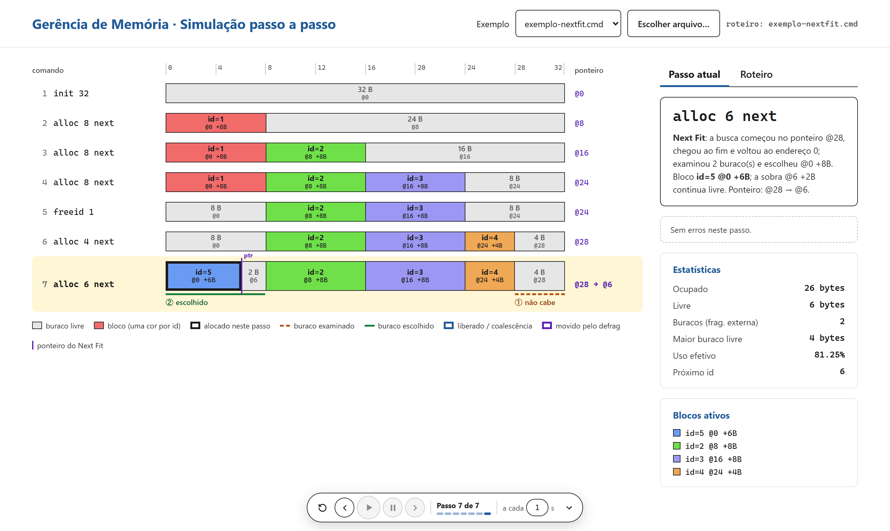

# Simulador de Alocação de Memória

Atividade prática de Sistemas Operacionais (UFC). O simulador mostra como o sistema operacional aloca e libera blocos de memória com **First Fit, Best Fit, Worst Fit e Next Fit**, calcula a fragmentação externa e desfragmenta a memória (**INIT, END e OPT**).

**Simulação visual online:** https://alocacao-de-memoria-so.vercel.app



São duas formas de uso, com o mesmo núcleo em Python:

- **Versão de terminal (CLI):** os comandos do enunciado, com a saída no formato do PDF.
- **Simulação visual:** uma página no navegador que executa um roteiro passo a passo (também publicada no link acima).

As decisões de implementação estão em [DOCUMENTACAO.md](DOCUMENTACAO.md).

## Requisitos

- Python 3.10 ou mais novo. Não há nada para instalar: só a biblioteca padrão.
- Um navegador atual (Chrome, Edge ou Firefox) para a simulação visual. Funciona sem internet.

## Versão de terminal

Rode os comandos a partir da pasta do projeto.

| Forma | Comando |
|---|---|
| Interativa (digite os comandos; `sair` encerra) | `python src/main.py` |
| Executar um roteiro, mostrando cada comando | `python src/main.py roteiros/exemplo-nextfit.cmd` |
| Executar pela entrada padrão (só as saídas, como no PDF), no PowerShell | `Get-Content roteiros\exemplo-sessao.cmd \| python src/main.py` |
| O mesmo no Prompt de Comando (cmd), Linux ou macOS | `python src/main.py < roteiros/exemplo-sessao.cmd` |

### Comandos

| Comando | O que faz |
|---|---|
| `init <tamanho>` | Cria a memória com um único buraco. Deve ser o primeiro comando; repetir reinicia tudo (ids e ponteiro). |
| `alloc <tamanho> <first\|best\|worst\|next>` | Aloca um bloco com o algoritmo escolhido. |
| `freeid <id>` | Libera o bloco pelo id. |
| `freeaddr <endereço>` | Libera o bloco que começa nesse endereço. |
| `show` | Mapa da memória, blocos ativos e estatísticas. |
| `stats` | Só as estatísticas. |
| `defrag <init\|end\|opt>` | Compacta a memória e mostra blocos movidos e bytes deslocados. |

Exemplo (sessão do enunciado):

```
> init 64
> alloc 10 first
> alloc 8 first
> freeid 2
> alloc 6 best
> show
Mapa de Memória (64 bytes)
------------------------------------------------------------------
[################................................................]
[1111111111333333................................................]
------------------------------------------------------------------

Blocos ativos: [id=1] @0 +10B (usado=10B) | [id=3] @10 +6B (usado=6B)
== Estatísticas ==
Tamanho total: 64 bytes
Ocupado: 16 bytes | Livre: 48 bytes
Buracos (fragmentação externa): 1
Maior buraco livre: 48 bytes
Uso efetivo: 25.00%
```

## Simulação visual

```
python src/servidor.py
```

O navegador abre em `http://127.0.0.1:8000`. Se a porta estiver ocupada, o servidor usa a próxima livre e mostra o endereço no terminal. Para escolher a porta: `python src/servidor.py 9000`. `Ctrl+C` encerra.

### Como carregar um roteiro

- Escolha um exemplo da pasta `roteiros/` na lista do topo, ou
- clique em **Escolher arquivo…** e selecione um `.cmd` (ou `.txt`) do computador.

O roteiro também pode ser alterado na aba **Roteiro** e executado de novo.

| Controle | Atalho |
|---|---|
| Avançar / Voltar | → / ← |
| Reproduzir / Pausar (intervalo em segundos, aceita `0,5`) | espaço |
| Reiniciar | Home |
| Ir direto a um passo | clicar na linha do passo |

## Roteiros

Um roteiro é um arquivo de texto (UTF-8) com um comando por linha, na mesma sintaxe da CLI. O mesmo arquivo roda nas duas versões.

```
# exemplo do Next Fit
init 32
alloc 8 next
alloc 8 next
alloc 8 next
freeid 1
alloc 4 next
alloc 6 next
```

- Linhas vazias e linhas que **começam** com `#` são ignoradas. Um `#` no meio da linha não é comentário.
- Na tela, `show` e `stats` também são ignorados, porque o mapa e as estatísticas estão sempre visíveis.
- Para comparar os algoritmos, troque `first`, `best`, `worst` e `next` no próprio roteiro.

| Exemplo em `roteiros/` | O que mostra |
|---|---|
| `exemplo-sessao.cmd` | A sessão interativa do enunciado. |
| `exemplo-nextfit.cmd` | A tabela do Next Fit do enunciado, com a busca voltando ao início. |
| `exemplo-defrag.cmd` | A tabela do defrag do enunciado (`defrag opt`). |
| `exemplo-erro.cmd` | Coalescência de três buracos e um `alloc` sem espaço contíguo. |

## Testes

```
python -m unittest discover -s tests -v
```

Os testes reproduzem os exemplos do PDF (sessão do `show`, tabela do Next Fit e tabela do defrag), os casos de borda das regras, a CLI de ponta a ponta e as rotas do servidor.

## Estrutura

```
src/        núcleo (bloco, memoria, algoritmos, defrag, formatacao, comandos),
            simulacao.py, main.py (CLI) e servidor.py (tela)
web/        index.html, estilo.css e js/ (main, api, historico, painel, editor)
api/        funções da Vercel (reaproveitam o src/servidor.py); config em vercel.json
roteiros/   roteiros de exemplo
tests/      testes automatizados
```
